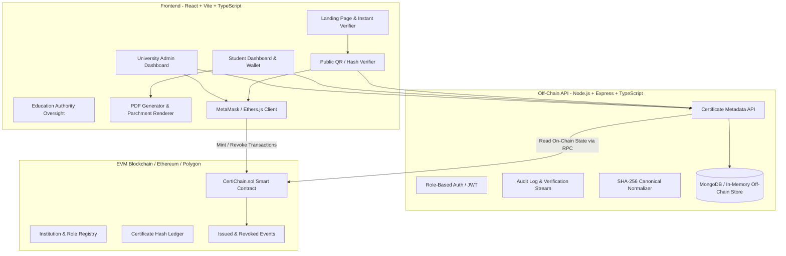

# CertiChain — System Architecture & Specification Plan

## 1. Executive Summary & Architecture Plan

**CertiChain** is a decentralized academic credential issuance and verification ecosystem. It combines cryptographic hashing (SHA-256 & Keccak-256), EVM-compatible Solidity smart contracts, off-chain metadata storage, and a responsive web application to eliminate certificate forgery and streamline third-party verification.

### System Architecture Diagram



---

## 2. Folder Structure

```
CertiCred/
├── contracts/                        # Solidity smart contracts & deployment artifacts
│   ├── CertiChain.sol               # Core ERC-like credential registry with RBAC
│   ├── deployment-info.json         # Deployed addresses, ABI, and network parameters
│   └── README.md                    # Remix IDE deployment and testing guide
│
├── server/                           # Node.js + Express + TypeScript REST API
│   ├── src/
│   │   ├── config/                  # Environment, DB connection, blockchain RPC config
│   │   ├── controllers/             # Auth, Certificate, Verifier, Analytics controllers
│   │   ├── middleware/              # JWT auth, role validation, rate limiting
│   │   ├── models/                  # Mongoose / TypeScript document models
│   │   ├── routes/                  # API routes (/api/auth, /api/certificates, /api/verify)
│   │   ├── services/                # Hash service, blockchain ethers reader, PDF helper
│   │   └── server.ts                # Express app entrypoint
│   ├── package.json
│   └── tsconfig.json
│
├── src/                              # Frontend React 19 + TypeScript + Vite
│   ├── assets/                      # Logos, seals, and illustrations
│   ├── components/                  # Reusable UI component library
│   │   ├── ui/                      # Buttons, Dialogs, Cards, Badges, Tabs, Tooltips
│   │   ├── CertificateInspectModal  # Official diploma parchment & cryptographic proof view
│   │   ├── CertificatePDFGenerator  # Printable client-side vector diploma PDF
│   │   ├── QRCodeModal              # Dynamic verification QR code popup
│   │   ├── RoleSwitcher             # Quick switcher between the 4 persona roles
│   │   ├── WalletConnect            # MetaMask / Web3 connection badge
│   │   ├── Header                   # Institutional navigation bar with search & alerts
│   │   └── Sidebar                  # Institutional midnight navy sidebar
│   ├── contexts/                    # Web3Context, AuthContext, NotificationContext
│   ├── data/                        # Labelled realistic fixtures & mock database
│   ├── hooks/                       # useWeb3, useCertificates, useDebounce
│   ├── pages/                       # Screen routes
│   │   ├── LandingPage              # Public landing with hero & drag-and-drop verifier
│   │   ├── AdminDashboard           # University registrar issuance, stats, & actions
│   │   ├── IssueCertificatePage     # Certificate issuance form with live parchment preview
│   │   ├── StudentDashboard         # Student credentials wallet and share links
│   │   ├── PublicVerifyPage         # Public QR / ID / PDF hash verification page
│   │   ├── AuthorityDashboard       # Read-only educational accreditation oversight
│   │   └── AnalyticsAuditPage       # On-chain transaction ledger and event history
│   ├── services/                    # Blockchain ethers client, API client, SHA-256 generator
│   ├── types/                       # Shared TypeScript interfaces
│   ├── App.tsx                      # Root application & routing
│   └── index.css                    # Tailwind CSS & design tokens
│
├── DESIGN.md                         # Institutional Trust Modernist design system
├── package.json                      # Frontend scripts and workspace runners
└── vite.config.ts                   # Vite configuration with proxy to server
```

---

## 3. Data Model

### A. On-Chain Struct (`CertiChain.sol`)
```solidity
struct OnChainCertificate {
    bytes32 certHash;         // SHA-256 / Keccak-256 digest of normalized certificate payload
    string certId;            // Unique alphanumeric identifier (e.g. CERT-2024-8841)
    address recipientWallet;  // Student EVM wallet address (optional, can be address(0))
    address issuer;           // Registrar custodian wallet address
    uint256 issueDate;        // Unix timestamp
    bool isRevoked;           // Revocation flag
    uint256 revokedDate;      // Timestamp of revocation (if applicable)
    string revocationReason;  // Cryptographic audit reason
}
```

### B. Off-Chain Document Schema (`MongoDB / Local Store`)
```typescript
interface CertificateDocument {
  certId: string;                   // "CERT-2024-8841" (Primary Unique Key)
  certHash: string;                 // Hex string (0x...) of SHA-256 payload
  txHash: string;                   // Blockchain transaction hash
  blockNumber: number;              // Minted block
  studentName: string;              // "Elena Rostova"
  studentUid: string;               // "SU-2020-0492"
  studentEmail: string;             // "erostova@stanford.edu"
  studentWallet?: string;           // "0x78a1...49c1"
  institutionName: string;          // "Stanford University"
  institutionId: string;            // "INST-STANFORD-001"
  department: string;               // "School of Engineering"
  degreeName: string;               // "M.S. in Computer Science"
  major: string;                    // "Artificial Intelligence"
  honors?: string;                  // "Summa Cum Laude"
  cgpa?: string;                    // "3.98 / 4.00"
  issueDate: string;                // ISO 8601
  status: "Verified" | "Revoked" | "Pending";
  metadataIpfsCid?: string;         // IPFS hash for decentralized preservation
  signatures: {
    registrarName: string;          // "Dr. Evelyn Vance"
    registrarRole: string;          // "University Registrar & Custodian"
    deanName: string;               // "Prof. Julian Thorpe"
    deanRole: string;               // "Dean of Academic Affairs"
  };
  revocation?: {
    revokedAt: string;
    revokedBy: string;
    reason: string;
    txHash: string;
  };
}
```

### C. User Authentication Model
```typescript
type UserRole = "ADMIN" | "STUDENT" | "VERIFIER" | "OVERSIGHT";

interface UserProfile {
  id: string;
  name: string;
  email: string;
  role: UserRole;
  institution?: string;
  studentUid?: string;
  walletAddress?: string;
}
```

---

## 4. Smart Contract Design (`CertiChain.sol`)

### Core Capabilities
1. **Role-Based Access Control (RBAC)**:
   - `DEFAULT_ADMIN_ROLE` (Contract deployer / Governance)
   - `ISSUER_ROLE` (Authorized University Registrars)
   - `REVOKER_ROLE` (Authorized University Disciplinary/Custodian Committee)
   - `OVERSIGHT_ROLE` (Accreditation Boards / Ministry of Education)
2. **Cryptographic Certificate Issuance**:
   - `issueCertificate(string certId, bytes32 certHash, address recipient)`:
     - Reverts if `certId` already registered.
     - Emits `CertificateIssued(certId, certHash, recipient, issuer, timestamp)`.
3. **Revocation with On-Chain Reason**:
   - `revokeCertificate(string certId, string reason)`:
     - Only callable by `REVOKER_ROLE` or original issuer.
     - Marks `isRevoked = true`, records timestamp & reason.
     - Emits `CertificateRevoked(certId, reason, revoker, timestamp)`.
4. **Trustless Public Verification Function**:
   - `verifyCertificate(string certId, bytes32 suppliedHash)` returns `(bool isValid, bool isRevoked, string institution, uint256 issueDate)`.
   - Returns `isValid = true` **strictly if** `storedHash == suppliedHash && !isRevoked`.

---

## 5. UI Page Map & Role Flows

| Page / Route | Primary Role | Key Capabilities |
| :--- | :--- | :--- |
| **`LandingPage`** (`/`) | Public / All | Hero introduction, instant search by Cert ID, drag-and-drop PDF hash calculation, features overview, quick launch. |
| **`AdminDashboard`** (`/admin`) | University Admin | Issuance stats, active batches, recent activity stream, quick actions, multi-sig signers status. |
| **`IssueCertificatePage`** (`/issue`) | University Admin | Full issuance form, dynamic payload hash computation, live side-by-side parchment diploma preview, MetaMask commit. |
| **`CertificatesLedger`** (`/certificates`) | Admin / Oversight | Filterable data table of all issued credentials, status pills, revocation action trigger, export CSV. |
| **`StudentDashboard`** (`/student`) | Student | Student wallet, issued diplomas, QR share code modal, high-resolution signed PDF download. |
| **`PublicVerifyPage`** (`/verify`) | Employer / Verifier | Trustless verifier: computes SHA-256 in browser, checks blockchain node, displays authentic parchment with official seal or revocation alert. |
| **`AuthorityDashboard`** (`/oversight`) | Education Authority | Read-only compliance metrics, multi-university issuance counts, fraud detection audit trail. |
| **`TransactionHistory`** (`/blockchain`) | All Roles | Live on-chain event stream, block explorer links, gas costs, and Merkle root anchors. |

---

## 6. Implementation Phases & Test Plan

### Phase 1: Architecture & Smart Contract Layer
- [x] Architecture specification and design document.
- [ ] Implement `contracts/CertiChain.sol` with complete events, custom errors, and verification methods.
- [ ] Provide deployment configuration, ABI export, and Remix IDE test scripts.

### Phase 2: Core Frontend Design System & Navigation Shell
- [ ] Install Lucide icons, Framer Motion, and required UI utilities.
- [ ] Implement Role Context & Role Switcher (Admin, Student, Verifier, Oversight).
- [ ] Build the Public Landing Page with instant verification widget.

### Phase 3: University Admin Issuance & Revocation Engine
- [ ] Issue Certificate workflow with live SHA-256 calculation.
- [ ] Live Parchment Preview with gold seal watermarks and signatures.
- [ ] Revocation workflow with confirmation modal, reason logging, and on-chain state update.

### Phase 4: Student Wallet & PDF Generation
- [ ] Student credential dashboard with interactive credential cards.
- [ ] Shareable QR code modal (direct verification deep link).
- [ ] Client-side PDF certificate generator with print and download capability.

### Phase 5: Trustless Public Verification Engine
- [ ] Dedicated verification screen supporting:
  1. Direct ID lookup (`CERT-2024-8841`)
  2. Drag-and-drop PDF/file SHA-256 hash calculation against on-chain hash
- [ ] Clear verified, revoked, and tampered visual feedback.

### Phase 6: Backend API & Verification Server (Node.js + Express)
- [ ] Set up Express backend with `/api/certificates`, `/api/verify`, and `/api/auth`.
- [ ] Implement dual storage: in-memory mock database with MongoDB connectivity.

### Phase 7: Testing & Verification Audit
- [ ] Verify build (`npm run build`).
- [ ] Test all role transitions and end-to-end flows.
- [ ] Document working features vs mocked items.
