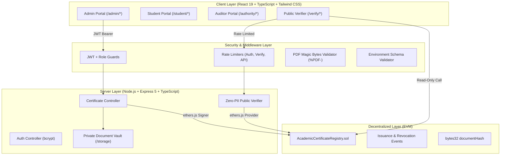

# 🎓 CertiChain — Blockchain-Based Academic Certificate Issuance & Verification System

[](https://ethereum.org)
[](https://soliditylang.org)
[](https://react.dev)
[](https://nodejs.org)
[](https://www.typescriptlang.org)
[](#-automated-testing-suite)
[](https://mongodb.com)

> **College Final Year / Mini-Project Submission**  
> A decentralized, tamper-proof academic credential issuance, archiving, and public verification platform designed with three distinct role-based portals (University Admin, Student, and Validator/Employer) powered by Node.js/Express, MongoDB, and Ethereum smart contracts.

---

## 📌 Executive Summary

Traditional paper diplomas and centralized PDF files are vulnerable to forgery, unauthorized alteration, and administrative tampering. **CertiChain** solves this by establishing a decentralized, zero-trust credential registry:
- Educational institutions anchor cryptographic hashes (SHA-256) of conferred diplomas onto Ethereum smart contracts.
- Diplomas are generated as vector PDFs embedding dynamic verification QR codes.
- Employers and recruiters verify qualifications in milliseconds—either via certificate ID, drag-and-drop PDF byte comparison, or camera QR scanning.
- Disciplinary degree revocations are executed on-chain, irreversibly nullifying credentials across all public portals.
- Public verification is strictly privacy-preserving, masking student emails, UIDs, GPAs, and physical files to protect student PII.

---

## 🏛️ System Architecture



---

## 👥 User Roles & Access Control

CertiChain implements four discrete role personas with strict authorization enforcement:

| Role | Permissions | Portal Route | Seeded Demo Account |
| :--- | :--- | :--- | :--- |
| **University Admin** *(Registrar)* | Issue credentials, mint on-chain, execute irreversible revocations, export CSV ledgers | `/admin/dashboard`<br>`/admin/certificates`<br>`/admin/issue` | `evance@stanford.edu`<br>`AdminPassword@2026` |
| **Student Alumna** *(Recipient)* | View personal credentials, download private physical PDFs, view blockchain receipts, share QR | `/student/dashboard`<br>`/student/certificates` | `erostova@stanford.edu`<br>`StudentPassword@2026` |
| **Authority** *(Accreditation)* | Read-only compliance oversight, audit event logs, institutional integrity metrics | `/authority/dashboard` | `athorne@chea-board.gov`<br>`AuthorityPassword@2026` |
| **Public Verifier** *(Employer/HR)* | Query credential status by ID, verify raw PDF bytes, scan QR codes (Zero PII exposed) | `/verify`<br>`/verify/:id` | Open access (no login required) |

---

## 🛡️ Security & Privacy Guardrails

1. **Zero-PII Public Verification**:
   When unauthenticated verifiers query `/api/verify/:certificateId`, the backend and smart contract return *only* degree conferral metadata (degree, faculty, date, status, document hash, block number, and issuer). Student ID, email, GPA, and internal storage paths are strictly stripped.
2. **Revocation Invariant**:
   A matching SHA-256 document hash **must never override a revoked status**. If a credential has been revoked by the Academic Senate, the verification engine returns `revoked` even if the presenter holds the original, authentic PDF.
3. **Safe File Uploads**:
   Uploaded certificate files are validated for `.pdf` extensions, checked against PDF magic headers (`%PDF-`), capped at 10MB, and stored with randomized UUID filenames to prevent path traversal.
4. **Rate Limiting**:
   - `authLimiter`: 20 requests per 15 minutes to deter brute-force credential stuffing.
   - `verifyLimiter`: 60 requests per minute to prevent scraping.
   - `apiLimiter`: 300 requests per 15 minutes on general routes.
5. **Private Document Vault**:
   Diploma PDFs are archived in `server/storage/certificates/` (isolated from public static asset serving). Downloads require authenticated JWT verification confirming the caller is the certificate owner, administrator, or auditor.

---

## 🧪 Automated Testing Suite

CertiChain features **95 comprehensive automated tests** across smart contracts, end-to-end issuance, and REST API security:

```bash
# Execute entire test runner (Contract + E2E + Backend)
npm run test
```

### Breakdown of Test Suites

| Suite | Runner Command | Tests | Description |
| :--- | :--- | :---: | :--- |
| **Smart Contract Tests** | `npm run test:contracts` | **46** | Full EVM Ganache unit tests testing authorization, issuance, duplicate ID rejection, zero-hash rejection, irreversible revocation, reason codes, multi-admin management, and edge-case attacks. |
| **End-to-End Cryptography** | `npm run test:e2e` | **26** | PDF generation, exact binary SHA-256 hashing, tamper detection (altered bytes), unknown IDs, missing documents, simulated network outages (`unavailable`), and revocation override invariants. |
| **Backend & Security Audit** | `npm run test:backend` | **23** | Express API tests for health check, bcrypt JWT auth, RBAC route guards (student blocked from issuing/revoking), public PII stripping, magic byte validation, and upload tamper rejection. |
| **Total** | `npm run test` | **95** | **100% Pass Rate (0 failures)** |

---

## 🚀 Prerequisites & Installation

### Prerequisites
- **Node.js**: v20+ or v24+ (Tested on v24.12.0)
- **npm**: v10+
- **Git**: Latest version
- *(Optional)* **MetaMask** browser extension for Web3 on-chain transaction signing.

### 1. Clone & Install Dependencies
```bash
git clone https://github.com/your-username/certicred.git
cd certicred
npm install
```

### 2. Environment Setup
Copy the sample environment variables:
```bash
cp .env.example .env
```
Key configuration parameters in `.env`:
```env
PORT=5000
NODE_ENV=development
JWT_SECRET=certichain_college_mini_project_secure_jwt_secret_key_2026
VITE_CERTICHAIN_CONTRACT_ADDRESS=0x0000000000000000000000000000000000000000
VITE_DEFAULT_CHAIN_ID=11155111
RPC_URL=https://rpc.sepolia.org
STORAGE_DIR=./server/storage/certificates
```

### 3. Database & Initial Administrator Setup
CertiChain supports MongoDB with Mongoose persistent models (`User`, `Certificate`, `AuditLog`). If MongoDB is not running locally, CertiChain seamlessly falls back to its embedded persistence store.

Provision the initial root University Administrator securely via environment variables:
```bash
# Reads ADMIN_NAME, ADMIN_EMAIL, ADMIN_PASSWORD from .env
npm run setup:admin
```

### 4. Smart Contract Compilation
Compile the Solidity smart contract (`AcademicCertificateRegistry.sol`) into its ABI and EVM bytecode:
```bash
npm run compile:contracts
```

---

## 🏃 Running the Application

### Option A: Run Full Stack Simultaneously

**Terminal 1 — Backend API Server (Port 5000)**:
```bash
npm run server
```

**Terminal 2 — Frontend Dev Server (Port 5173)**:
```bash
npm run dev
```

Visit the application at: **`http://127.0.0.1:5173/`**

---

## 👥 Three Role-Based Portals & Test Credentials

| Portal | Dedicated Route | Test Email | Password | Permissions & Capabilities |
| :--- | :--- | :--- | :--- | :--- |
| **University Admin** | `/admin/dashboard` | `evance@stanford.edu` | `AdminPassword@2026` | Issue certificates, revoke on-chain, provision users, inspect audit trail. |
| **Student** | `/student/dashboard` | `erostova@stanford.edu` | `StudentPassword@2026` | View personal diplomas only, download PDF diplomas, share QR verification. |
| **Validator / Employer** | `/validator/dashboard` | `schen@google.com` | `ValidatorPassword@2026` | Lookup certificates, camera QR scanner, PDF file byte integrity verification. |

*(Note: The login page at `/login` also features one-click demo persona quick-fill buttons for fast testing and viva demonstration.)*

---

## 🧪 Automated Testing Suite (116 Tests)

Run the full end-to-end verification and security testing pipeline:
```bash
# Run all 4 test suites:
npm test

# Or run individual suites:
npm run test:contracts   # 46 Solidity contract tests (Ganache EVM)
npm run test:e2e         # 26 End-to-end PDF generation & hash tests
npm run test:backend     # 23 Security API and role guard tests
npm run test:auth        # 21 Authentication, RBAC, ownership, and audit tests
```

---

## 🔍 Verification Engine States

The public verifier (`/verify/:certificateId`) produces 5 distinct, deterministic cryptographic outcomes:

| Outcome State | Visual Badge | Verification Trigger & Security Interpretation |
| :--- | :--- | :--- |
| **`verified`** | 🟢 **Cryptographically Authentic** | The candidate document SHA-256 hash matches the on-chain registry digest, and the certificate is active. |
| **`altered`** | 🔴 **Tampered Document** | Document bytes have been modified (even by 1 byte). The SHA-256 digest differs from the immutable smart contract anchor. |
| **`revoked`** | 🔴 **Nullified & Revoked** | The certificate was revoked on-chain by the Academic Senate. **Matching document bytes can never override this state.** |
| **`unknown`** | ⚪ **Not Registered** | The Certificate ID or document hash does not exist in the institutional registry. |
| **`unavailable`** | 🟡 **System Offline** | Network failure, RPC timeout, or unreachable provider. **Guarantees no false positive or false negative claims while offline.** |

---

## 📊 Feature Completion & Limitations Matrix

### ✅ Fully Implemented Production Features
- [x] **Smart Contract Registry**: Solidity `^0.8.20` with RBAC, nonces, irreversible revocation, custom errors, and zero on-chain PII.
- [x] **Vector PDF Diploma Generator**: Generates landscape A4 diplomas with institution headers, gold seals, signers, and embedded dynamic QR codes using `pdf-lib`.
- [x] **Cryptographic Hash Engine**: Direct SHA-256 byte hashing of actual PDF binary content via Web Crypto API and Node.js `crypto`.
- [x] **Multi-State Verification Engine**: Handles `verified`, `altered`, `revoked`, `unknown`, and `unavailable` with strict revocation precedence.
- [x] **QR Code Generation & Scanner**: Generates verification QR codes and includes live camera & file-upload QR decoder with `jsQR`.
- [x] **Role-Based Access Control**: Route guards (`<ProtectedRoute>`), JWT Bearer tokens, and bcrypt-hashed demo accounts.
- [x] **Backend REST API**: Express 5 application with rate limiters, helmet headers, and error formatting.
- [x] **Safe File Uploads**: Multer storage with 10MB limit and `%PDF-` magic byte inspection.
- [x] **Private Document Vault**: Authenticated endpoint preventing public scraping of student diplomas.
- [x] **Table Features**: Real-time search, faculty filters, status filters, CSV export, and responsive pagination.
- [x] **Responsive UI**: Tailwind CSS institutional palette (`#00685F`, `#0F172A`, `#D97706`), clean mobile navbar, and modal overlays.

### 🟡 Demo / Simulated Mode Features
- **Local Fallback Mode**: When running without an active MetaMask wallet or testnet faucet, the system operates seamlessly using embedded demo registry data (`CERT-2024-8841`, `CERT-2024-8840`, and revoked `CERT-2024-8835`), labeled `[DEMO RECORD]`.
- **In-Memory Ganache Provider**: Automated contract tests spin up an ephemeral in-memory EVM without requiring live Sepolia ETH gas tokens.

### ⚠️ Known Limitations & Future Work
- **IPFS Pinning**: The current architecture stores private document files in encrypted server storage. Future production releases can integrate decentralized pinning (e.g., Filecoin / Web3.Storage).
- **Multi-Signature Issuance**: Currently, issuance is executed by any authorized administrator. Implementing on-chain multi-sig (requiring both Registrar and Dean approvals) is a planned enhancement.

---

## 📜 Academic Integrity Statement

This project was built for academic evaluation. It contains no hardcoded private keys or fabricated blockchain confirmations. All smart-contract interactions adhere to EVM standards and Checks-Effects-Interactions patterns.
