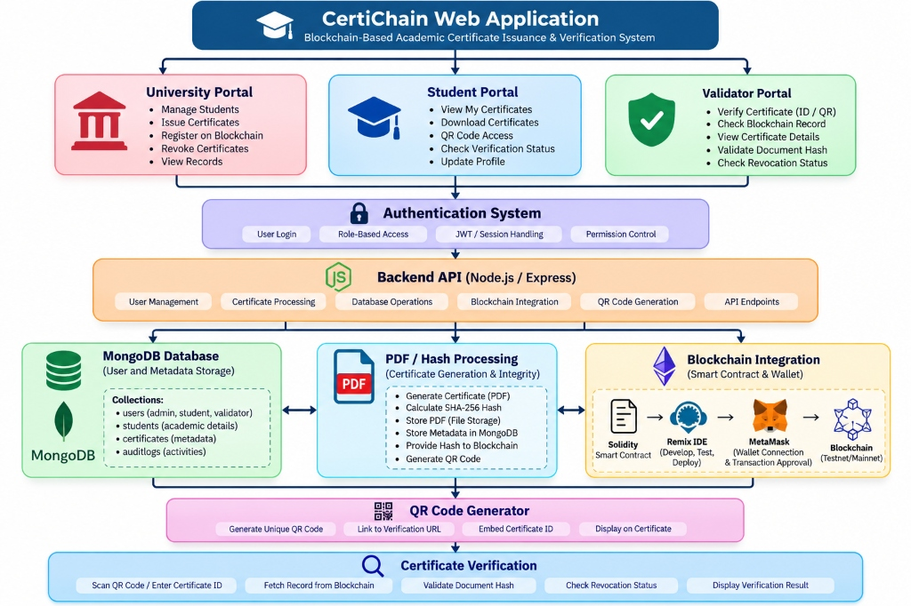
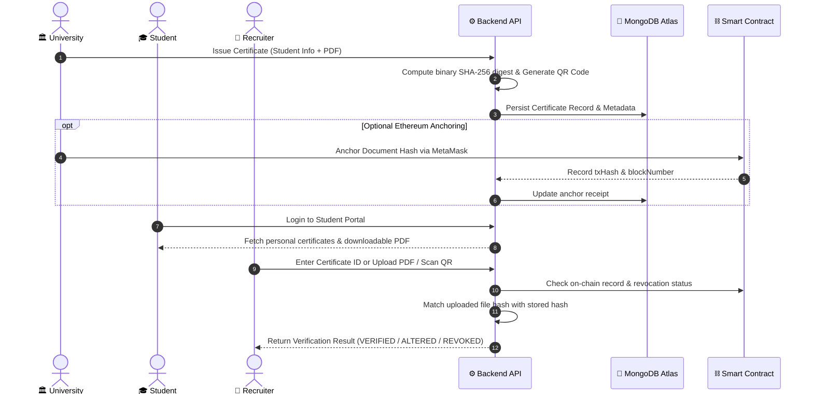

# 🎓 CertiChain — Blockchain-Based Academic Certificate Issuance & Verification System

[](https://ethereum.org)
[](https://soliditylang.org)
[](https://react.dev)
[](https://nodejs.org)
[](https://mongodb.com)
[](https://www.typescriptlang.org)
[](#-automated-testing-suite-116-tests)

A decentralized, tamper-proof academic certificate issuance and instant verification platform designed around **three core stakeholders**: **University**, **Student**, and **Recruiter**. Built with React, Node.js/Express, MongoDB, and Ethereum smart contracts.

---

## 🏛️ System Architecture



The platform is organized into three primary client portals supported by an authentication system, Express REST API, MongoDB database, cryptographic PDF hashing engine, and Ethereum smart contract registry.

---

## 👥 Three Core Portals & Stakeholders

CertiChain is structured specifically for three roles:

### 1. 🏛️ University Portal (College Admin)
- **Manage Students & Records**: View registered students and institutional issuance history.
- **Issue Academic Certificates**:
  - Upload custom PDF certificates or dynamically generate digital degree certificates.
  - Automatically calculate exact binary SHA-256 cryptographic hashes.
  - Generate and embed dynamic QR codes linking directly to public verification.
- **Blockchain Anchoring (Optional)**: Anchor certificate hashes onto an Ethereum/Sepolia smart contract using MetaMask.
- **Revocation Management**: Irreversibly revoke fraudulent or invalidated certificates on-chain and in the database with audit reasons.

### 2. 🎓 Student Portal (Recipient)
- **View My Certificates**: Real-time access to issued degrees, diplomas, and credentials.
- **Download Certificates**: Download official high-resolution PDF certificates with cryptographic seals and QR codes.
- **QR Code Sharing**: Share unique verification QR codes with employers and institutions.
- **Verification Status**: Monitor credential validity, SHA-256 digest, and blockchain confirmation status.
- **Profile Management**: Manage dynamic user profile and credentials.

### 3. 💼 Recruiter Portal (Validator / Employer)
- **Instant Certificate Verification**: Lookup and verify credentials via Certificate ID or QR code.
- **Tamper Detection (Document Hash Validation)**: Drag-and-drop any received PDF diploma to verify its cryptographic SHA-256 hash against the immutable registry.
- **Smart Contract & Registry Check**: View on-chain timestamp, block number, and authorized issuer details.
- **Revocation Checking**: Instantly identify revoked or nullified certificates.

---

## 🔄 How It Works (End-to-End Flow)



---

## 🔍 Verification Outcomes

When credentials are submitted for verification (`/verify` or Recruiter Portal), the engine produces 5 deterministic results:

| Outcome State | Badge | Description |
| :--- | :--- | :--- |
| **`verified`** | 🟢 **Authentic** | Document SHA-256 matches the registry/blockchain record, and the certificate is active. |
| **`altered`** | 🔴 **Tampered** | Document content was modified (even by 1 byte). Hash does not match the immutable record. |
| **`revoked`** | 🔴 **Revoked** | Certificate has been revoked by the university. **Matching document bytes never override revocation.** |
| **`unknown`** | ⚪ **Not Found** | The Certificate ID or hash is not registered in the institutional repository. |
| **`unavailable`** | 🟡 **Offline** | Network or RPC provider unreachable. Guarantees no false positive/negative claims while offline. |

---

## 🛠️ Technology Stack

| Layer | Technologies |
| :--- | :--- |
| **Frontend** | React 19, TypeScript, Vite, Tailwind CSS, Lucide Icons |
| **Backend** | Node.js, Express, TypeScript, Multer, bcrypt, jsonwebtoken |
| **Database** | MongoDB Atlas, Mongoose ODM |
| **Blockchain** | Solidity `^0.8.20`, ethers.js v6, Hardhat, Remix IDE, MetaMask |
| **Cryptography & PDFs** | Web Crypto API, Node.js `crypto` (SHA-256), `pdf-lib`, `qrcode`, `jsQR` |

---

## 🧪 Automated Testing Suite (116 Tests)

CertiChain comes with **116 automated tests** with 100% pass rate:

```bash
npm test
```

### Test Breakdown:
- **Smart Contract Tests (46 tests)**: EVM unit tests for role-based authorization, duplicate ID prevention, non-zero hash requirements, irreversible revocation, and edge cases.
- **End-to-End Cryptography (26 tests)**: PDF byte generation, exact SHA-256 matching, tamper detection, missing documents, and revocation override invariants.
- **Backend & Security API (23 tests)**: REST endpoints, JWT authentication, RBAC authorization, zero-PII public verification, and file upload validation.
- **Authentication & RBAC (21 tests)**: Dynamic user registration, password hashing, student ownership isolation, and audit log tracking.

---

## 🚀 Getting Started

### 1. Prerequisites
- **Node.js**: v20+ or v24+
- **npm**: v10+
- **MongoDB**: MongoDB Atlas connection string or local MongoDB instance

### 2. Installation
```bash
# Clone the repository
git clone https://github.com/imtiyazkhan03/CrediChain.git
cd CrediChain

# Install project dependencies
npm install
```

### 3. Environment Configuration
Create a `.env` file in the root directory (refer to [.env.example](.env.example)):
```env
PORT=5000
NODE_ENV=development
JWT_SECRET=your_super_secret_jwt_key_at_least_32_characters
MONGODB_URI=your_mongodb_connection_string
STORAGE_DIR=./server/storage/certificates
VITE_CERTICHAIN_CONTRACT_ADDRESS=0x358AA13c52544ECCEF6B0ADD0f801012ADAD5eE3
VITE_DEFAULT_CHAIN_ID=11155111
RPC_URL=https://rpc.sepolia.org
```

### 4. Run the Application

```bash
# Terminal 1 — Start Backend Server (Port 5000)
npm run server

# Terminal 2 — Start Frontend Application (Port 5173)
npm run dev
```

Open your browser and visit: **`http://localhost:5173`**

---

## 🔑 Login & Role Accounts

You can register a new dynamic account directly via the **Sign Up** tab on the Login page (`/login`) for any role:

| Stakeholder Role | Access Portal | Default Capabilities |
| :--- | :--- | :--- |
| **University** | `/admin/dashboard` | Issue certificates, view records, optional blockchain anchor, revoke. |
| **Student** | `/student/dashboard` | View credentials, download PDFs, view verification QR code. |
| **Recruiter** | `/validator/dashboard` | Verify certificates by ID or QR, upload PDF for tamper inspection. |

---

## 📁 Project Structure

```text
├── contracts/                     # Solidity smart contract & compilation scripts
│   ├── AcademicCertificateRegistry.sol
│   └── tests/
├── backend/                       # Express API & MongoDB backend
│   └── src/
│       ├── controllers/           # Auth, Certificate, Student, Validator controllers
│       ├── middleware/            # JWT auth, RBAC guards, Multer upload, rate limiters
│       ├── models/                # User, Certificate, AuditLog schemas
│       ├── routes/                # API routes
│       └── services/              # SHA-256 and storage vault services
├── src/                           # React frontend client
│   ├── components/                # Reusable UI cards, modals, navigation
│   ├── contexts/                  # AuthContext, CertificateContext, Web3Context
│   ├── pages/                     # University, Student, Recruiter & Public Verify pages
│   ├── services/                  # PDF generation, hashing, verification engine
│   └── styles/
├── docs/                          # Architecture diagrams and technical documentation
└── test/                          # Comprehensive 116-test automated test suite
```

---

## 📜 License & Academic Note

This project is created for educational and academic evaluation purposes. Built with robust zero-trust cryptographic verification, role-based security, and privacy protection.
