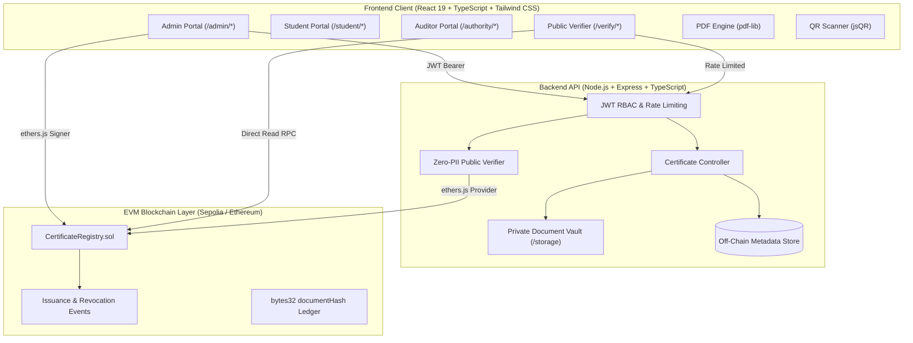

# CertiChain — System Architecture Documentation

## 1. High-Level Architecture Overview

CertiChain is a hybrid on-chain / off-chain academic credential platform designed to provide mathematical proof of degree authenticity while preserving strict student data privacy (zero PII on-chain).

---

## 2. Component Boundaries & Responsibilities

### 2.1. Frontend (`frontend/`)
- **Pages**:
  - `LandingPage`: Public hero, instant search bar, metric cards, verification workflow demonstration.
  - `LoginPage`: Persona quick-select, credential form, JWT token acquisition.
  - `AdminDashboardPage`: Real-time audit metrics, batch minting activity charts, quick revocation triggers.
  - `AdminCertificatesPage`: Full ledger with search, faculty filter, status filter, CSV export, and responsive pagination.
  - `AdminIssuePage`: Validated degree issuance form with live SHA-256 payload preview and vector parchment preview.
  - `StudentDashboardPage` & `StudentCertificatesPage`: Recipient portfolio, private document download, and shareable QR codes.
  - `PublicVerifyPage`: Public verifier handling 5 distinct states (`verified`, `altered`, `revoked`, `unknown`, `unavailable`), live camera QR scanning, and drag-and-drop PDF dropzone.
  - `AuthorityDashboardPage`: Regulatory compliance inspection, cryptographic audit stream.
- **Layouts & Guards**:
  - `AppLayout`: Universal top navigation, mobile sidebar, and modal root.
  - `ProtectedRoute`: Role-based route guard blocking unauthorized roles and unauthenticated verifiers.

### 2.2. Backend (`backend/`)
- **Controllers**:
  - `authController`: Bcrypt authentication, JWT creation, user session retrieval.
  - `certificateController`: Off-chain metadata registry, role-scoped certificate listing, authenticated private document downloads.
  - `verifyController`: Public verifier stripping student PII, exact binary SHA-256 computation over uploaded PDF files, strict revocation precedence enforcement.
- **Middleware**:
  - `auth`: Bearer JWT token verification and `requireRole` authorization.
  - `rateLimiter`: IP-based rate limiting on authentication, verification, and general API endpoints.
  - `upload`: Safe file storage with random UUID paths, 10MB limit, and `%PDF-` magic byte inspection.
  - `validate`: Input schema validation for credentials, issuance, and revocation.

### 2.3. Smart Contract (`contracts/`)
- **`CertificateRegistry.sol`**:
  - EVM Solidity contract (`^0.8.20`).
  - Stores only `bytes32 documentHash`, issuer address, issued timestamp, revocation boolean, revocation timestamp, and non-sensitive reason code / docket hash.
  - Enforces checks-effects-interactions, custom error reverts, and irreversible revocation.
  - Emits `CertificateIssued`, `CertificateRevoked`, and `IssuerAuthorized` events.

---

## 3. Cryptographic Security Model

1. **Exact Binary Hashing**:
   The document hash is computed strictly over the final byte array of the generated PDF (`Uint8Array`), NOT over JSON strings or database records. Any modification (e.g. changing 1 character in a student's name or GPA) produces a completely different SHA-256 digest, triggering the `altered` state.
2. **Revocation Precedence Invariant**:
   A matching document hash **never overrides a revoked status**. Even if an adversary presents the authentic, original PDF, the smart contract's `isRevoked` flag takes absolute precedence.
3. **Availability Fault Tolerance**:
   Network outages or RPC failures deterministically produce an `unavailable` outcome. The verifier never returns a false positive (`verified`) or false negative (`altered`/`unknown`) when connectivity is disrupted.
